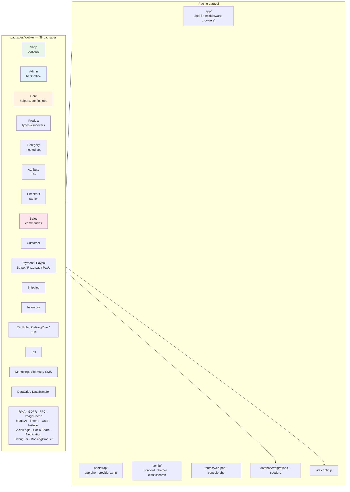
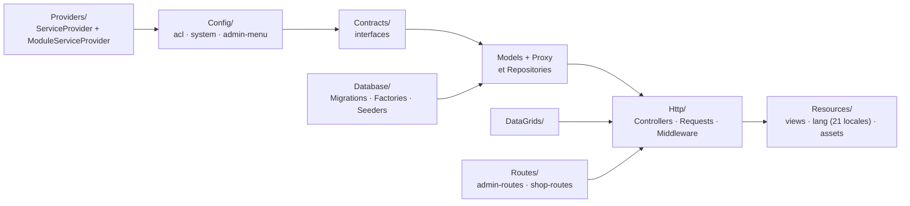
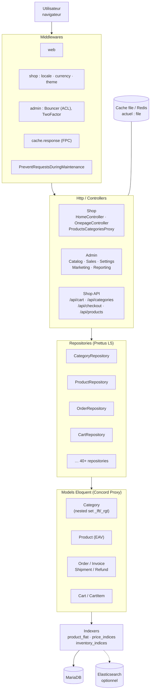
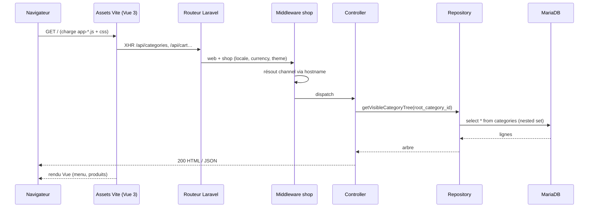
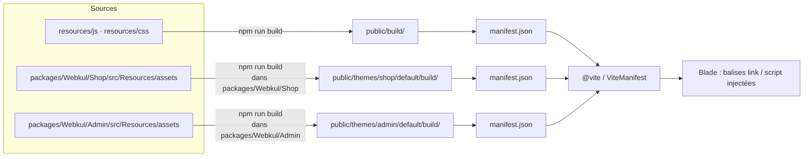
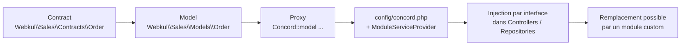

# Architecture

## 1. Vue d'ensemble du monorepo

Chaque package suit la même structure interne :

## 2. Couches applicatives

## 3. Cycle d'une requête (boutique)

## 4. Pipeline de build frontend

> `public/themes/*/build/` est en `.gitignore` côté Bagisto standard mais **présent ici**
> (artefacts déjà compilés). Modifier un fichier source impose de recompiler le thème concerné.

## 5. Système de modules Concord

## 6. Points d'extension du projet

| Besoin | Où intervenir |
|---|---|
| Modification boutique (Vue/Blade) | `packages/Webkul/Shop/src/Resources` → recompiler |
| Modification admin | `packages/Webkul/Admin/src/Resources` → recompiler |
| Nouvelles tables | `database/migrations/` (racine) ou `packages/Webkul/*/src/Database/Migrations` |
| Nouveau package | Contract + Model + Proxy + Repository, enregistrer dans `bootstrap/providers.php` **et** `config/concord.php` |
| Config système admin | `packages/Webkul/*/src/Config/system.php` |
| ACL admin | `packages/Webkul/*/src/Config/acl.php` |
| Menu admin | `packages/Webkul/*/src/Config/admin-menu.php` |
