# Base de données — `louzir_mode_intime`

MariaDB 10.4.32 (XAMPP, `127.0.0.1:3306`), jeu de caractères `utf8mb4_unicode_ci`.
**146 tables**, générées par les migrations des packages Webkul (`php artisan bagisto:install`).

## 1. Domaines du schéma

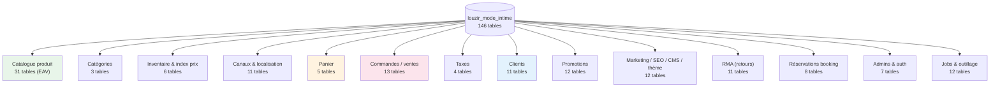

## 2. Diagrammes ER par domaine

### 2.1 Catalogue produit (EAV)

```mermaid
erDiagram
    attribute_families ||--o{ attribute_groups : contains
    attribute_families ||--o{ products : types
    attributes ||--o{ attribute_group_mappings : maps_to
    attribute_groups ||--o{ attribute_group_mappings : holds
    attributes ||--o{ attribute_options : offers
    attribute_options ||--o{ attribute_option_translations : translates
    attributes ||--o{ attribute_translations : translates
    products ||--o{ products : parent_child
    products ||--o{ product_attribute_values : owns
    attributes ||--o{ product_attribute_values : fills
    products ||--o{ product_flat : flattens
    attribute_families ||--o{ product_flat : indexes
    product_flat ||--o{ product_flat : variant_of
    products ||--o{ product_images : has_media
    products ||--o{ product_videos : has_media
    products ||--o{ product_reviews : receives
    product_reviews ||--o{ product_review_attachments : has_media
    products ||--o{ product_super_attributes : varies_by
    attributes ||--o{ product_super_attributes : configures
    products ||--o{ product_relations : relates
    products ||--o{ product_up_sells : upsells
    products ||--o{ product_cross_sells : cross_sells
    products ||--o{ product_grouped_products : groups
    products ||--o{ product_bundle_options : bundles
    product_bundle_options ||--o{ product_bundle_option_products : contains
    products ||--o{ product_bundle_option_products : contributes
    product_bundle_options ||--o{ product_bundle_option_translations : translates
    products ||--o{ product_customizable_options : customizes
    product_customizable_options ||--o{ product_customizable_option_prices : prices
    product_customizable_options ||--o{ product_customizable_option_translations : translates
    products ||--o{ product_downloadable_links : ships
    products ||--o{ product_downloadable_samples : previews
    product_downloadable_links ||--o{ product_downloadable_link_translations : translates
    product_downloadable_samples ||--o{ product_downloadable_sample_translations : translates
    customer_groups ||--o{ product_customer_group_prices : prices_for
    products ||--o{ product_customer_group_prices : prices_for
```

### 2.2 Catégories (nested set)

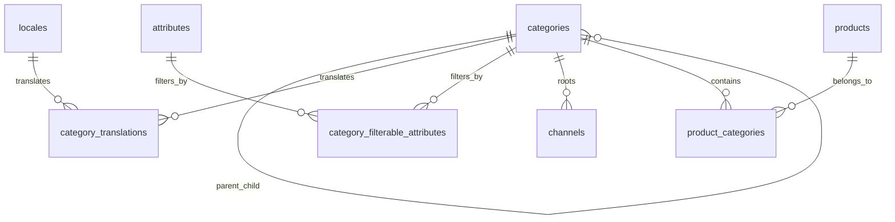

> `categories` utilise **nested set** (`_lft`, `_rgt`, `parent_id`) — `kalnoy/nestedset`.
> Le canal racine pointe sur `categories.id = 1` (`Root`).

### 2.3 Inventaire, canaux & localisation

```mermaid
erDiagram
    channels ||--o{ channel_translations : translates
    channels ||--o{ channel_locales : speaks
    locales ||--o{ channel_locales : speaks
    channels ||--o{ channel_currencies : sells_in
    currencies ||--o{ channel_currencies : sells_in
    channels ||--o{ channel_inventory_sources : stocks_from
    inventory_sources ||--o{ channel_inventory_sources : stocks_from
    locales ||--o{ channels : default_for
    currencies ||--o{ channels : base_for
    currencies ||--o{ currency_exchange_rates : converts_to
    countries ||--o{ country_states : divides_into
    countries ||--o{ country_translations : translates
    country_states ||--o{ country_state_translations : translates
    inventory_sources ||--o{ product_inventories : stocks
    products ||--o{ product_inventories : stocked_at
    products ||--o{ product_channels : published_on
    channels ||--o{ product_channels : published_on
    products ||--o{ product_price_indices : priced
    channels ||--o{ product_price_indices : priced
    customer_groups ||--o{ product_price_indices : priced
    products ||--o{ product_inventory_indices : counted
    channels ||--o{ product_inventory_indices : counted
    products ||--o{ product_ordered_inventories : reserved
    channels ||--o{ product_ordered_inventories : reserved
```

### 2.4 Panier

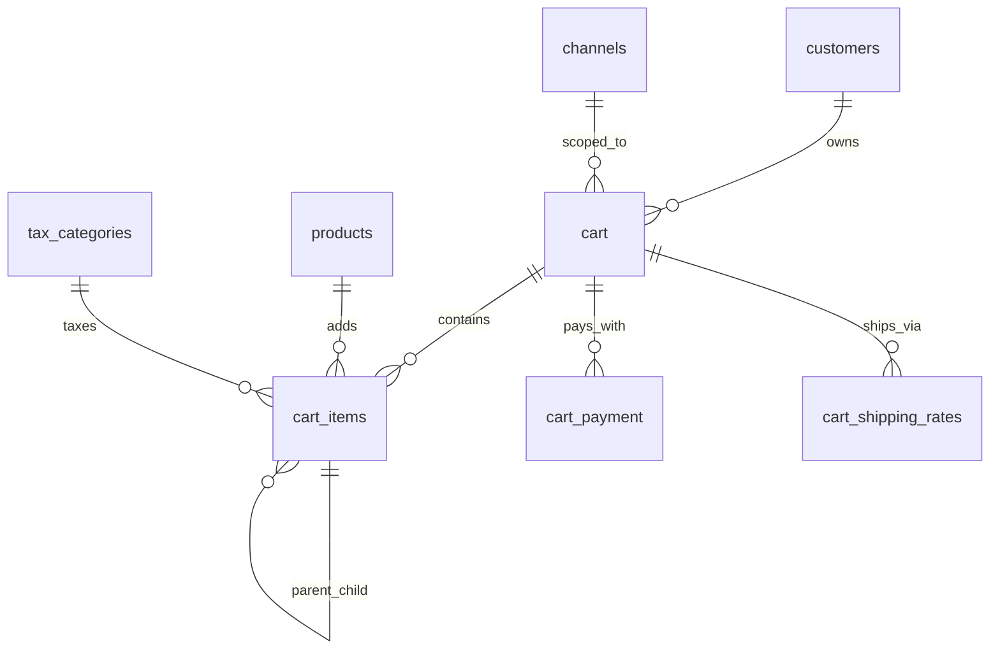

### 2.5 Commandes / ventes

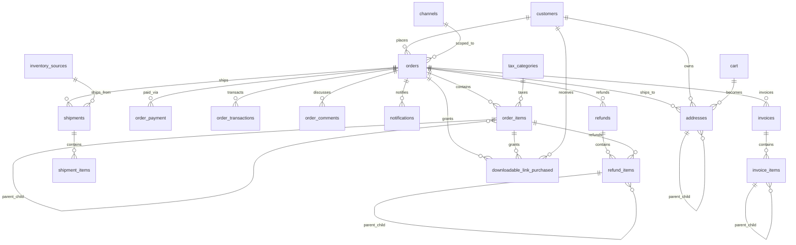

### 2.6 Clients

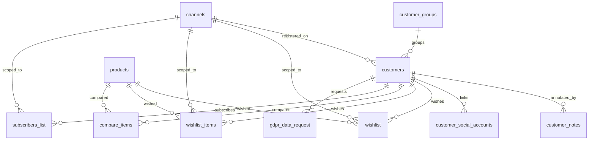

### 2.7 Promotions (panier & catalogue)

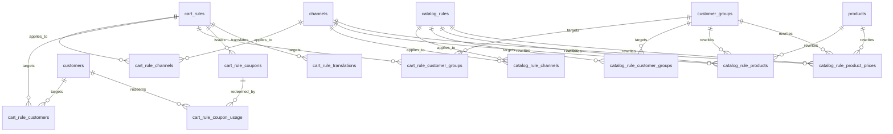

### 2.8 Marketing, SEO, CMS & thème

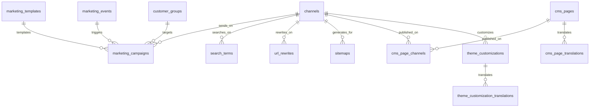

### 2.9 RMA (retours)

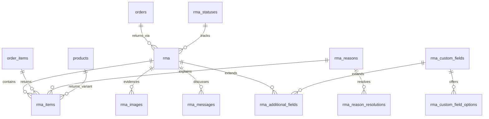

### 2.10 Réservations (Booking)

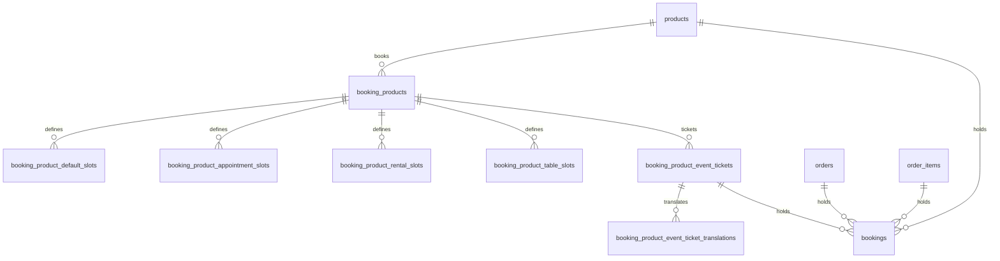

### 2.11 Administration & infra technique

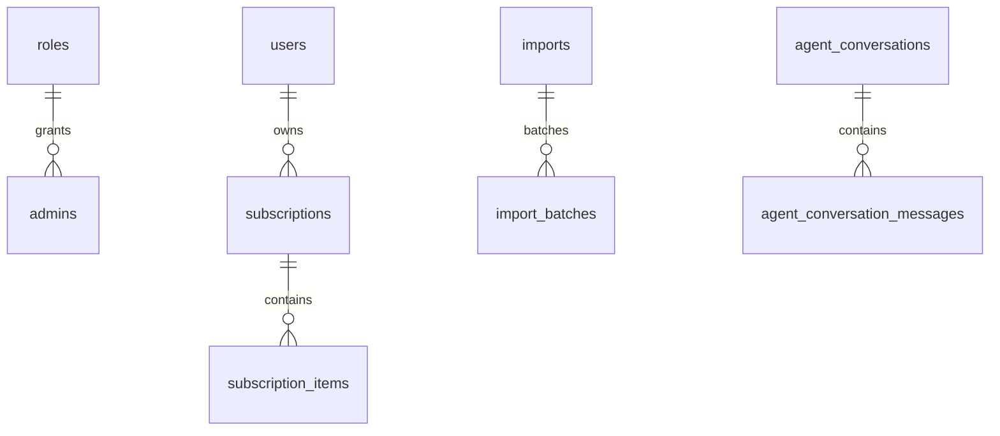

> `roles`→`admins` (`role_id`), `users`→`subscriptions` (`user_id`) et
> `agent_conversations.user_id` sont des **liens logiques sans contrainte FK en base**.

> Les tables `sessions`, `jobs`, `job_batches`, `failed_jobs`, `notifications` (hors `order_id`),
> `migrations`, `core_config`, `password_resets`, `admin_password_resets`, `personal_access_tokens`,
> `datagrid_saved_filters` sont des tables techniques **sans clé étrangère métier**.

## 3. Inventaire des 146 tables

> Nb lignes ≈ (estimation InnoDB, `information_schema.TABLE_ROWS`).

### Catalogue produit — 31 tables

| Table | Lignes | Rôle |
|---|---|---|
| `products` | 0 | Entité produit (type simple/configurable/virtual…) |
| `product_attribute_values` | 0 | Valeurs EAV par produit |
| `attributes` | 30 | Attributs EAV (name, price, color…) |
| `attribute_translations` | 30 | Traductions d'attribut |
| `attribute_families` | 1 | Famille d'attributs |
| `attribute_groups` | 8 | Groupes d'attributs |
| `attribute_group_mappings` | 30 | Attribut ↔ groupe |
| `attribute_options` | 9 | Options d'attribut (liste) |
| `attribute_option_translations` | 9 | Traductions d'options |
| `product_flat` | 0 | Table dénormalisée pour l'affichage/la recherche |
| `product_images` | 0 | Images produit |
| `product_videos` | 0 | Vidéos produit |
| `product_reviews` | 0 | Avis clients |
| `product_review_attachments` | 0 | Pièces jointes d'avis |
| `product_super_attributes` | 0 | Attributs de variantes (configurable) |
| `product_relations` | 0 | Relations produit ↔ produit |
| `product_up_sells` | 0 | Upsells |
| `product_cross_sells` | 0 | Cross-sells |
| `product_grouped_products` | 0 | Produits groupés |
| `product_bundle_options` | 0 | Options bundle |
| `product_bundle_option_products` | 0 | Contenu des options bundle |
| `product_bundle_option_translations` | 0 | Traductions bundle |
| `product_customizable_options` | 0 | Options personnalisées |
| `product_customizable_option_prices` | 0 | Prix des options personnalisées |
| `product_customizable_option_translations` | 0 | Traductions options |
| `product_downloadable_links` | 0 | Liens téléchargeables |
| `product_downloadable_link_translations` | 0 | Traductions liens |
| `product_downloadable_samples` | 0 | Échantillons téléchargeables |
| `product_downloadable_sample_translations` | 0 | Traductions échantillons |
| `product_customer_group_prices` | 0 | Prix par groupe client |
| `product_categories` | 0 | Produit ↔ catégorie |

### Catégories — 3 tables

| Table | Lignes | Rôle |
|---|---|---|
| `categories` | 1 | Arbre nested set (`_lft`,`_rgt`,`parent_id`) |
| `category_translations` | 1 | Nom / slug / description par locale |
| `category_filterable_attributes` | 0 | Attributs de filtre par catégorie |

### Inventaire & index — 6 tables

| Table | Lignes | Rôle |
|---|---|---|
| `inventory_sources` | 1 | Entrepôts / sources de stock |
| `channel_inventory_sources` | 1 | Canal ↔ source |
| `product_inventories` | 0 | Stock par produit/source |
| `product_inventory_indices` | 0 | Index de stock (canal) |
| `product_price_indices` | 0 | Index de prix (canal + groupe client) |
| `product_ordered_inventories` | 0 | Stock réservé par commandes |

### Canaux & localisation — 11 tables

| Table | Lignes | Rôle |
|---|---|---|
| `channels` | 1 | Canal de vente (hostname, devise, locale, catégorie racine) |
| `channel_translations` | 0 | Nom / logo du canal |
| `channel_locales` | 1 | Locales activées |
| `channel_currencies` | 1 | Devises activées |
| `locales` | 1 | Locales disponibles |
| `currencies` | 1 | Devises |
| `currency_exchange_rates` | 0 | Taux de change |
| `countries` | 254 | Pays |
| `country_states` | 586 | États/régions |
| `country_translations` | 0 | Noms de pays traduits |
| `country_state_translations` | 0 | Noms d'états traduits |

### Panier — 5 tables

| Table | Lignes | Rôle |
|---|---|---|
| `cart` | 0 | Panier (client ou invité) |
| `cart_items` | 0 | Lignes de panier |
| `cart_item_inventories` | 0 | Réservation de stock du panier |
| `cart_payment` | 0 | Méthode de paiement choisie |
| `cart_shipping_rates` | 0 | Taux de livraison sélectionné |

### Commandes / ventes — 13 tables

| Table | Lignes | Rôle |
|---|---|---|
| `orders` | 0 | Commande |
| `order_items` | 0 | Lignes de commande |
| `order_payment` | 0 | Paiement de la commande |
| `order_transactions` | 0 | Transactions de paiement |
| `order_comments` | 0 | Commentaires admin/client |
| `invoices` | 0 | Facture |
| `invoice_items` | 0 | Lignes de facture |
| `shipments` | 0 | Expédition |
| `shipment_items` | 0 | Lignes d'expédition |
| `refunds` | 0 | Remboursement |
| `refund_items` | 0 | Lignes de remboursement |
| `addresses` | 0 | Adresses (panier, commande, client) |
| `notifications` | 0 | Notifications (dont `order_id`) |

### Taxes — 4 tables

| Table | Lignes | Rôle |
|---|---|---|
| `tax_categories` | 0 | Catégorie de taxe |
| `tax_rates` | 0 | Taux de taxe |
| `tax_categories_tax_rates` | 0 | Catégorie ↔ taux |
| `tax_mappings` | 0 | Mappe catégorie de taxe par pays/région |

### Clients — 11 tables

| Table | Lignes | Rôle |
|---|---|---|
| `customers` | 1 | Compte client |
| `customer_groups` | 3 | Groupes (general, wholesale, guest) |
| `customer_notes` | 0 | Notes admin sur client |
| `customer_password_resets` | 0 | Réinitialisation mot de passe |
| `customer_social_accounts` | 0 | Comptes OAuth |
| `wishlist` | 0 | Wishlist (ancien schéma) |
| `wishlist_items` | 0 | Articles wishlist |
| `compare_items` | 0 | Comparateur |
| `subscribers_list` | 1 | Newsletter |
| `gdpr_data_request` | 0 | Demandes GDPR |
| `downloadable_link_purchased` | 0 | Liens achetés (produits téléchargeables) |

### Promotions — 12 tables

| Table | Lignes | Rôle |
|---|---|---|
| `cart_rules` | 0 | Règle de panier (promo) |
| `cart_rule_channels` | 0 | Règle ↔ canal |
| `cart_rule_customers` | 0 | Règle ↔ clients ciblés |
| `cart_rule_customer_groups` | 0 | Règle ↔ groupes |
| `cart_rule_coupons` | 0 | Coupons |
| `cart_rule_coupon_usage` | 0 | Utilisation des coupons |
| `cart_rule_translations` | 0 | Traductions de règle |
| `catalog_rules` | 0 | Règle de prix catalogue |
| `catalog_rule_channels` | 0 | Règle ↔ canal |
| `catalog_rule_customer_groups` | 0 | Règle ↔ groupes |
| `catalog_rule_products` | 0 | Produits ciblés |
| `catalog_rule_product_prices` | 0 | Prix générés par la règle |

### Marketing / SEO / CMS / thème — 12 tables

| Table | Lignes | Rôle |
|---|---|---|
| `marketing_templates` | 0 | Modèles d'email |
| `marketing_events` | 1 | Événements marketing |
| `marketing_campaigns` | 0 | Campagnes |
| `search_terms` | 0 | Termes de recherche (SEO) |
| `search_synonyms` | 0 | Synonymes de recherche |
| `url_rewrites` | 0 | Réécritures d'URL |
| `sitemaps` | 0 | Sitemaps XML |
| `cms_pages` | 10 | Pages CMS |
| `cms_page_channels` | 10 | Page ↔ canal |
| `cms_page_translations` | 10 | Contenu CMS par locale |
| `theme_customizations` | 13 | Sections du thème (menu, home…) |
| `theme_customization_translations` | 13 | Traductions des sections |

### RMA (retours) — 11 tables

| Table | Lignes | Rôle |
|---|---|---|
| `rma` | 0 | Demande de retour |
| `rma_items` | 0 | Articles retournés |
| `rma_images` | 0 | Preuves photo |
| `rma_messages` | 0 | Fil de discussion |
| `rma_additional_fields` | 0 | Champs additionnels |
| `rma_custom_fields` | 0 | Champs personnalisés |
| `rma_custom_field_options` | 0 | Options des champs |
| `rma_reasons` | 5 | Motifs de retour |
| `rma_reason_resolutions` | 10 | Résolutions liées aux motifs |
| `rma_rules` | 1 | Politique de retour |
| `rma_statuses` | 9 | Statuts |

### Réservations Booking — 8 tables

| Table | Lignes | Rôle |
|---|---|---|
| `booking_products` | 0 | Configuration de réservation |
| `booking_product_default_slots` | 0 | Créneaux par défaut |
| `booking_product_appointment_slots` | 0 | Créneaux sur rendez-vous |
| `booking_product_rental_slots` | 0 | Créneaux de location |
| `booking_product_table_slots` | 0 | Créneaux de table |
| `booking_product_event_tickets` | 0 | Billets d'événement |
| `booking_product_event_ticket_translations` | 0 | Traductions billets |
| `bookings` | 0 | Réservation (liée à la commande) |

### Admins & auth — 7 tables

| Table | Lignes | Rôle |
|---|---|---|
| `admins` | 1 | Compte admin |
| `roles` | 1 | Rôles / permissions (ACL) |
| `users` | 0 | Users Laravel (Cashier, OAuth) |
| `sessions` | 11 | Sessions (`SESSION_DRIVER=database`) |
| `password_resets` | 0 | Reset mot de passe users |
| `admin_password_resets` | 0 | Reset mot de passe admin |
| `personal_access_tokens` | 0 | Sanctum API tokens |

### Jobs & outillage — 12 tables

| Table | Lignes | Rôle |
|---|---|---|
| `jobs` | 0 | File de jobs |
| `job_batches` | 0 | Batches de jobs |
| `failed_jobs` | 0 | Jobs échoués |
| `migrations` | 181 | Historique des migrations |
| `core_config` | 21 | Configuration admin (clé/valeur/canal) |
| `imports` | 0 | Imports CSV (DataTransfer) |
| `import_batches` | 0 | Lots d'import |
| `datagrid_saved_filters` | 0 | Filtres sauvegardés (DataGrid) |
| `subscriptions` | 0 | Abonnements (Laravel Cashier) |
| `subscription_items` | 0 | Lignes d'abonnement |
| `agent_conversations` | 0 | Conversations IA (MagicAI) |
| `agent_conversation_messages` | 0 | Messages IA |

## 4. Relations complètes (clés étrangères)

| Table | Colonne | Table cible | Colonne cible |
|---|---|---|---|
| `addresses` | `parent_address_id` | `addresses` | `id` |
| `addresses` | `order_id` | `orders` | `id` |
| `addresses` | `customer_id` | `customers` | `id` |
| `addresses` | `cart_id` | `cart` | `id` |
| `attribute_groups` | `attribute_family_id` | `attribute_families` | `id` |
| `attribute_group_mappings` | `attribute_id` | `attributes` | `id` |
| `attribute_group_mappings` | `attribute_group_id` | `attribute_groups` | `id` |
| `attribute_options` | `attribute_id` | `attributes` | `id` |
| `attribute_option_translations` | `attribute_option_id` | `attribute_options` | `id` |
| `attribute_translations` | `attribute_id` | `attributes` | `id` |
| `bookings` | `booking_product_event_ticket_id` | `booking_product_event_tickets` | `id` |
| `bookings` | `product_id` | `products` | `id` |
| `bookings` | `order_item_id` | `order_items` | `id` |
| `bookings` | `order_id` | `orders` | `id` |
| `booking_products` | `product_id` | `products` | `id` |
| `booking_product_appointment_slots` | `booking_product_id` | `booking_products` | `id` |
| `booking_product_default_slots` | `booking_product_id` | `booking_products` | `id` |
| `booking_product_event_tickets` | `booking_product_id` | `booking_products` | `id` |
| `booking_product_event_ticket_translations` | `booking_product_event_ticket_id` | `booking_product_event_tickets` | `id` |
| `booking_product_rental_slots` | `booking_product_id` | `booking_products` | `id` |
| `booking_product_table_slots` | `booking_product_id` | `booking_products` | `id` |
| `cart` | `customer_id` | `customers` | `id` |
| `cart` | `channel_id` | `channels` | `id` |
| `cart_items` | `tax_category_id` | `tax_categories` | `id` |
| `cart_items` | `product_id` | `products` | `id` |
| `cart_items` | `parent_id` | `cart_items` | `id` |
| `cart_items` | `cart_id` | `cart` | `id` |
| `cart_payment` | `cart_id` | `cart` | `id` |
| `cart_rule_channels` | `channel_id` | `channels` | `id` |
| `cart_rule_channels` | `cart_rule_id` | `cart_rules` | `id` |
| `cart_rule_coupons` | `cart_rule_id` | `cart_rules` | `id` |
| `cart_rule_coupon_usage` | `customer_id` | `customers` | `id` |
| `cart_rule_coupon_usage` | `cart_rule_coupon_id` | `cart_rule_coupons` | `id` |
| `cart_rule_customers` | `customer_id` | `customers` | `id` |
| `cart_rule_customers` | `cart_rule_id` | `cart_rules` | `id` |
| `cart_rule_customer_groups` | `customer_group_id` | `customer_groups` | `id` |
| `cart_rule_customer_groups` | `cart_rule_id` | `cart_rules` | `id` |
| `cart_rule_translations` | `cart_rule_id` | `cart_rules` | `id` |
| `cart_shipping_rates` | `cart_id` | `cart` | `id` |
| `catalog_rule_channels` | `channel_id` | `channels` | `id` |
| `catalog_rule_channels` | `catalog_rule_id` | `catalog_rules` | `id` |
| `catalog_rule_customer_groups` | `customer_group_id` | `customer_groups` | `id` |
| `catalog_rule_customer_groups` | `catalog_rule_id` | `catalog_rules` | `id` |
| `catalog_rule_products` | `catalog_rule_id` | `catalog_rules` | `id` |
| `catalog_rule_products` | `product_id` | `products` | `id` |
| `catalog_rule_products` | `customer_group_id` | `customer_groups` | `id` |
| `catalog_rule_products` | `channel_id` | `channels` | `id` |
| `catalog_rule_product_prices` | `channel_id` | `channels` | `id` |
| `catalog_rule_product_prices` | `catalog_rule_id` | `catalog_rules` | `id` |
| `catalog_rule_product_prices` | `product_id` | `products` | `id` |
| `catalog_rule_product_prices` | `customer_group_id` | `customer_groups` | `id` |
| `category_filterable_attributes` | `category_id` | `categories` | `id` |
| `category_filterable_attributes` | `attribute_id` | `attributes` | `id` |
| `category_translations` | `category_id` | `categories` | `id` |
| `category_translations` | `locale_id` | `locales` | `id` |
| `channels` | `root_category_id` | `categories` | `id` |
| `channels` | `default_locale_id` | `locales` | `id` |
| `channels` | `base_currency_id` | `currencies` | `id` |
| `channel_currencies` | `currency_id` | `currencies` | `id` |
| `channel_currencies` | `channel_id` | `channels` | `id` |
| `channel_inventory_sources` | `inventory_source_id` | `inventory_sources` | `id` |
| `channel_inventory_sources` | `channel_id` | `channels` | `id` |
| `channel_locales` | `channel_id` | `channels` | `id` |
| `channel_locales` | `locale_id` | `locales` | `id` |
| `channel_translations` | `channel_id` | `channels` | `id` |
| `cms_page_channels` | `cms_page_id` | `cms_pages` | `id` |
| `cms_page_channels` | `channel_id` | `channels` | `id` |
| `cms_page_translations` | `cms_page_id` | `cms_pages` | `id` |
| `compare_items` | `product_id` | `products` | `id` |
| `compare_items` | `customer_id` | `customers` | `id` |
| `country_states` | `country_id` | `countries` | `id` |
| `country_state_translations` | `country_state_id` | `country_states` | `id` |
| `country_translations` | `country_id` | `countries` | `id` |
| `currency_exchange_rates` | `target_currency` | `currencies` | `id` |
| `customers` | `customer_group_id` | `customer_groups` | `id` |
| `customers` | `channel_id` | `channels` | `id` |
| `customer_notes` | `customer_id` | `customers` | `id` |
| `customer_social_accounts` | `customer_id` | `customers` | `id` |
| `downloadable_link_purchased` | `order_item_id` | `order_items` | `id` |
| `downloadable_link_purchased` | `order_id` | `orders` | `id` |
| `downloadable_link_purchased` | `customer_id` | `customers` | `id` |
| `gdpr_data_request` | `customer_id` | `customers` | `id` |
| `import_batches` | `import_id` | `imports` | `id` |
| `invoices` | `order_id` | `orders` | `id` |
| `invoice_items` | `parent_id` | `invoice_items` | `id` |
| `invoice_items` | `invoice_id` | `invoices` | `id` |
| `marketing_campaigns` | `marketing_template_id` | `marketing_templates` | `id` |
| `marketing_campaigns` | `marketing_event_id` | `marketing_events` | `id` |
| `marketing_campaigns` | `customer_group_id` | `customer_groups` | `id` |
| `marketing_campaigns` | `channel_id` | `channels` | `id` |
| `notifications` | `order_id` | `orders` | `id` |
| `orders` | `customer_id` | `customers` | `id` |
| `orders` | `channel_id` | `channels` | `id` |
| `order_comments` | `order_id` | `orders` | `id` |
| `order_items` | `tax_category_id` | `tax_categories` | `id` |
| `order_items` | `parent_id` | `order_items` | `id` |
| `order_items` | `order_id` | `orders` | `id` |
| `order_payment` | `order_id` | `orders` | `id` |
| `order_transactions` | `order_id` | `orders` | `id` |
| `products` | `parent_id` | `products` | `id` |
| `products` | `attribute_family_id` | `attribute_families` | `id` |
| `product_attribute_values` | `attribute_id` | `attributes` | `id` |
| `product_attribute_values` | `product_id` | `products` | `id` |
| `product_bundle_options` | `product_id` | `products` | `id` |
| `product_bundle_option_products` | `product_id` | `products` | `id` |
| `product_bundle_option_products` | `product_bundle_option_id` | `product_bundle_options` | `id` |
| `product_bundle_option_translations` | `product_bundle_option_id` | `product_bundle_options` | `id` |
| `product_categories` | `product_id` | `products` | `id` |
| `product_categories` | `category_id` | `categories` | `id` |
| `product_channels` | `product_id` | `products` | `id` |
| `product_channels` | `channel_id` | `channels` | `id` |
| `product_cross_sells` | `parent_id` | `products` | `id` |
| `product_cross_sells` | `child_id` | `products` | `id` |
| `product_customer_group_prices` | `product_id` | `products` | `id` |
| `product_customer_group_prices` | `customer_group_id` | `customer_groups` | `id` |
| `product_customizable_options` | `product_id` | `products` | `id` |
| `product_customizable_option_prices` | `product_customizable_option_id` | `product_customizable_options` | `id` |
| `product_customizable_option_translations` | `product_customizable_option_id` | `product_customizable_options` | `id` |
| `product_downloadable_links` | `product_id` | `products` | `id` |
| `product_downloadable_link_translations` | `product_downloadable_link_id` | `product_downloadable_links` | `id` |
| `product_downloadable_samples` | `product_id` | `products` | `id` |
| `product_downloadable_sample_translations` | `product_downloadable_sample_id` | `product_downloadable_samples` | `id` |
| `product_flat` | `product_id` | `products` | `id` |
| `product_flat` | `parent_id` | `product_flat` | `id` |
| `product_flat` | `attribute_family_id` | `attribute_families` | `id` |
| `product_grouped_products` | `product_id` | `products` | `id` |
| `product_grouped_products` | `associated_product_id` | `products` | `id` |
| `product_images` | `product_id` | `products` | `id` |
| `product_inventories` | `inventory_source_id` | `inventory_sources` | `id` |
| `product_inventories` | `product_id` | `products` | `id` |
| `product_inventory_indices` | `channel_id` | `channels` | `id` |
| `product_inventory_indices` | `product_id` | `products` | `id` |
| `product_ordered_inventories` | `channel_id` | `channels` | `id` |
| `product_ordered_inventories` | `product_id` | `products` | `id` |
| `product_price_indices` | `channel_id` | `channels` | `id` |
| `product_price_indices` | `product_id` | `products` | `id` |
| `product_price_indices` | `customer_group_id` | `customer_groups` | `id` |
| `product_relations` | `child_id` | `products` | `id` |
| `product_relations` | `parent_id` | `products` | `id` |
| `product_reviews` | `product_id` | `products` | `id` |
| `product_review_attachments` | `review_id` | `product_reviews` | `id` |
| `product_super_attributes` | `product_id` | `products` | `id` |
| `product_super_attributes` | `attribute_id` | `attributes` | `id` |
| `product_up_sells` | `parent_id` | `products` | `id` |
| `product_up_sells` | `child_id` | `products` | `id` |
| `product_videos` | `product_id` | `products` | `id` |
| `refunds` | `order_id` | `orders` | `id` |
| `refund_items` | `refund_id` | `refunds` | `id` |
| `refund_items` | `parent_id` | `refund_items` | `id` |
| `refund_items` | `order_item_id` | `order_items` | `id` |
| `rma` | `rma_status_id` | `rma_statuses` | `id` |
| `rma` | `order_id` | `orders` | `id` |
| `rma_additional_fields` | `rma_id` | `rma` | `id` |
| `rma_additional_fields` | `rma_custom_field_id` | `rma_custom_fields` | `id` |
| `rma_custom_field_options` | `rma_custom_field_id` | `rma_custom_fields` | `id` |
| `rma_images` | `rma_id` | `rma` | `id` |
| `rma_items` | `rma_reason_id` | `rma_reasons` | `id` |
| `rma_items` | `rma_id` | `rma` | `id` |
| `rma_items` | `order_item_id` | `order_items` | `id` |
| `rma_items` | `variant_id` | `products` | `id` |
| `rma_messages` | `rma_id` | `rma` | `id` |
| `rma_reason_resolutions` | `rma_reason_id` | `rma_reasons` | `id` |
| `search_terms` | `channel_id` | `channels` | `id` |
| `shipments` | `order_id` | `orders` | `id` |
| `shipments` | `inventory_source_id` | `inventory_sources` | `id` |
| `shipment_items` | `shipment_id` | `shipments` | `id` |
| `subscribers_list` | `customer_id` | `customers` | `id` |
| `subscribers_list` | `channel_id` | `channels` | `id` |
| `tax_categories_tax_rates` | `tax_category_id` | `tax_categories` | `id` |
| `tax_categories_tax_rates` | `tax_rate_id` | `tax_rates` | `id` |
| `theme_customizations` | `channel_id` | `channels` | `id` |
| `theme_customization_translations` | `theme_customization_id` | `theme_customizations` | `id` |
| `wishlist` | `product_id` | `products` | `id` |
| `wishlist` | `customer_id` | `customers` | `id` |
| `wishlist` | `channel_id` | `channels` | `id` |
| `wishlist_items` | `channel_id` | `channels` | `id` |
| `wishlist_items` | `product_id` | `products` | `id` |
| `wishlist_items` | `customer_id` | `customers` | `id` |

## 5. Notes de modélisation

- **EAV** : `attributes` + `attribute_families` + `attribute_groups` + `product_attribute_values`.
  `product_flat` dénormalise pour la lecture (rebuilt par indexer).
- **Nested set** : `categories._lft/_rgt` (kalnoy/nestedset) — requêtes d'arbre sans récursion.
- **Concord Proxy** : chaque modèle a un `*Proxy` permettant le remplacement par un module custom.
- **Multi-canal** : presque toutes les tables métier portent un lien `channel_id`
  (`product_channels`, `cart`, `orders`, `theme_customizations`…).
- **Traductions** : tables `*_translations` avec 21 locales supportées.
- **Index construits** : `product_price_indices`, `product_inventory_indices`, `product_flat`
  sont régénérés par les indexers (`packages/Webkul/Product/src/Indexers/*`).
