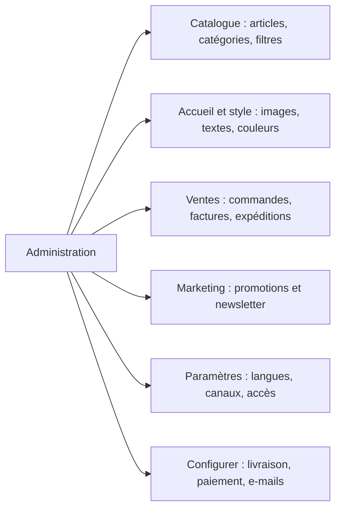
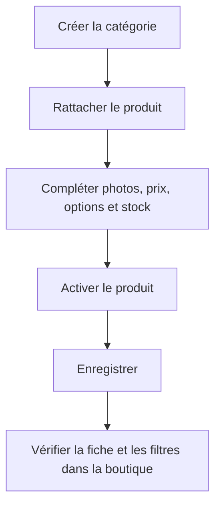
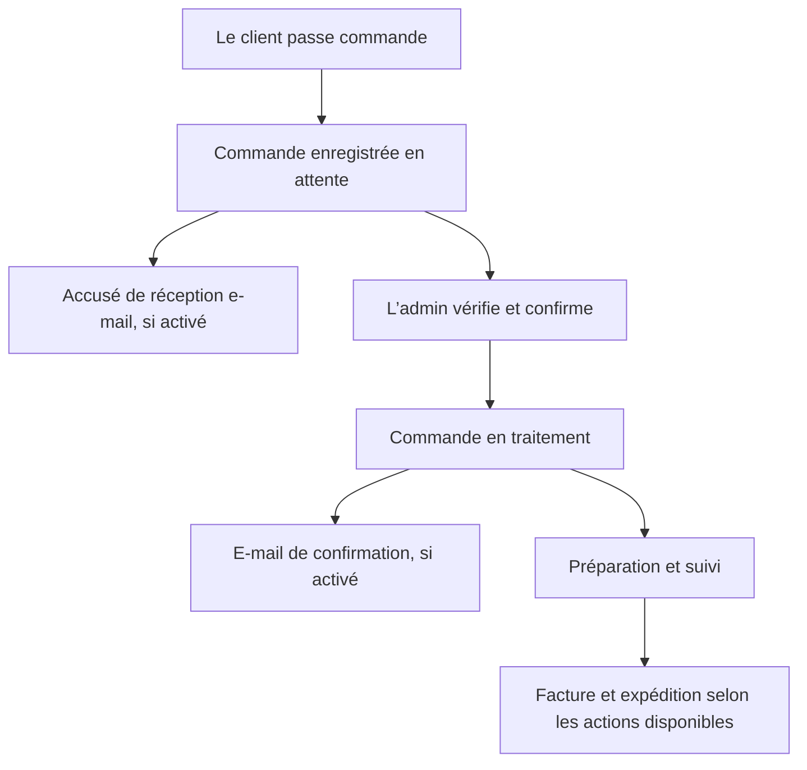
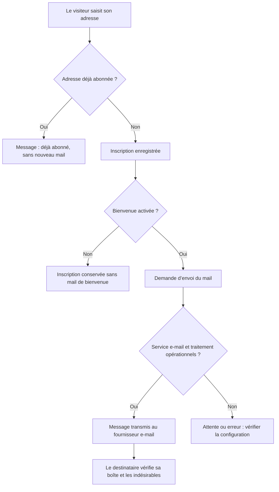

# Guide simple de l’administration — Louzir Mode Intime

**À quoi sert ce guide ?** À gérer les produits, l’apparence de la boutique, les commandes et les communications, sans modifier le code.

Ce guide décrit les menus et réglages du projet au **26 octobre 2026**. Certains écrans dépendent des droits de votre compte et des modules utilisés par la boutique.

## Sommaire

1. [Bien commencer](#1-bien-commencer)
2. [Où modifier quoi ?](#2-où-modifier-quoi)
3. [Produits, catégories et filtres](#3-produits-catégories-et-filtres)
4. [Accueil et apparence](#4-accueil-et-apparence)
5. [Articles similaires](#5-articles-similaires)
6. [Commandes et livraison](#6-commandes-et-livraison)
7. [E-mails et newsletter](#7-e-mails-et-newsletter)
8. [Clients, promotions et pages](#8-clients-promotions-et-pages)
9. [Paramètres et accès](#9-paramètres-et-accès)
10. [Problèmes courants et routine quotidienne](#10-problèmes-courants-et-routine-quotidienne)

## 1. Bien commencer

- **Admin local** : <http://127.0.0.1:8000/admin>.
- **Admin du site publié** : <https://louzirmodeintime-production.up.railway.app/admin>.
- Connectez-vous avec votre compte administrateur.

**Local et site publié sont deux environnements différents.** Modifier un produit, un tarif ou le SMTP en local ne modifie pas automatiquement le site publié. Un déploiement du code ne copie pas les réglages enregistrés dans la base locale.

Sur les écrans qui le proposent :

1. Choisissez le **canal** : la boutique concernée par le réglage.
2. Choisissez la **langue** : français, anglais ou arabe.
3. Modifiez le champ souhaité.
4. Cliquez sur **Enregistrer** ou **Enregistrer la configuration**.
5. Ouvrez la boutique et vérifiez le résultat, sur téléphone aussi si vous changez une image ou un texte important.

**Paramètres** sert notamment aux comptes, langues et canaux. **Configurer** contient les réglages de fonctionnement et de présentation.

## 2. Où modifier quoi ?

| Je souhaite… | Menu à ouvrir |
| --- | --- |
| Ajouter un article, changer son prix ou ses photos | **Catalogue → Produits** |
| Créer une rubrique ou une sous-rubrique | **Catalogue → Catégories** |
| Modifier Couleur, Taille, Marque ou leurs options | **Catalogue → Attributs** |
| Modifier le carrousel et les textes d’accueil | **Configurer → Général → Accueil Louzir** |
| Changer les couleurs et polices du site | **Accueil Louzir → Style de toute la boutique** |
| Choisir les articles similaires | **Configurer → Catalogue → Produits → Page de visualisation du produit** |
| Consulter ou confirmer une commande | **Ventes → Commandes** |
| Modifier les tarifs de livraison | **Configurer → Ventes → Modes de livraison** |
| Configurer l’expéditeur et le SMTP | **Configurer → E-mails → Configurer** |
| Activer les notifications de commande | **Configurer → E-mails → Notifications** |
| Gérer les abonnés ou une campagne newsletter | **Marketing → Communications** |
| Créer un code promotionnel | **Marketing → Promotions → Règles du panier** |
| Rédiger une page d’information | **CMS** |
| Changer le logo de la boutique | **Paramètres → Canaux → Modifier le canal** |
| Changer le logo de l’administration | **Configurer → Général → Design** |
| Créer un compte pour un collaborateur | **Paramètres → Utilisateurs**, puis **Rôles** |
| Consulter les statistiques | **Tableau de bord** ou **Rapport** |

## 3. Produits, catégories et filtres

### Ajouter ou modifier un produit

**Chemin : Catalogue → Produits.**

1. Cliquez sur **Créer un produit**, ou ouvrez un produit existant.
2. Renseignez le nom, la référence de l’article — appelée **SKU** — et son prix.
3. Ajoutez des photos et une description claire : matière, coupe, entretien et informations utiles.
4. Choisissez les catégories auxquelles il appartient.
5. Vérifiez les quantités en stock et la source de stock concernée.
6. Complétez les options proposées : taille, couleur ou autres caractéristiques.
7. Activez le produit et sa visibilité individuelle si vous souhaitez qu’il apparaisse comme un article autonome.
8. Enregistrez, puis ouvrez sa fiche dans la boutique.

Les champs **Nouveau** et **En vedette**, lorsqu’ils sont disponibles, permettent de mettre l’article en avant. Une remise peut aussi être gérée avec les champs de prix promotionnel ou avec les règles de promotion.

Pour un article vendu en plusieurs tailles ou couleurs, utilisez le type de produit adapté aux variantes. Vérifiez le prix et le stock de chaque variante, pas seulement ceux de la fiche principale.

### Organiser les catégories

**Chemin : Catalogue → Catégories.**

Vous pouvez gérer le nom, la description, l’image de bannière, l’état actif et la position d’une catégorie.

Pour créer une sous-catégorie, choisissez une catégorie existante comme **parent**. Exemple : **Lingerie → Soutiens-gorge**.

Le menu de la boutique reprend cette organisation. Le nom ouvre la catégorie ; la flèche permet d’afficher ses sous-catégories.

Une bannière propre à une catégorie est prioritaire sur l’image commune réglée dans **Accueil Louzir**. Le mode d’affichage peut présenter les produits, la description, ou les deux. Une catégorie configurée uniquement pour son contenu ne présente pas de liste de produits à filtrer.

### Gérer les filtres

**Chemin : Catalogue → Attributs**, puis les attributs filtrables associés à la catégorie.

- Un **attribut** est une caractéristique : Couleur, Taille, Marque…
- Ses **options** sont les valeurs proposées : Noir, Blanc, S, M, L…
- Renseignez les libellés dans les langues concernées. Les textes personnalisés de l’admin restent prioritaires.
- Les attributs associés à une catégorie déterminent ses filtres. Sans association particulière, la boutique utilise les attributs généraux marqués comme filtrables.

Les intitulés standards et les couleurs standards disposent d’une traduction de secours en français, anglais et arabe. Les noms particuliers de vos matières, marques ou collections doivent être renseignés dans l’admin.

Côté client, les tailles sont proposées en cases et les couleurs peuvent avoir une pastille. Le client choisit ses options puis clique sur **Appliquer les filtres**. Sur téléphone, le bouton **Filtre** ouvre le volet.

## 4. Accueil et apparence

**Chemin principal : Configurer → Général → Accueil Louzir.**

| Section | Ce que vous pouvez modifier |
| --- | --- |
| **Style de toute la boutique** | Fonds, encadrés et dégradés, couleurs du texte, boutons et bordures, polices, largeur du contenu et image commune des collections. |
| **Carrousel** | Affichage du carrousel, activation des trois diapositives, images, titres, descriptions, boutons et liens. |
| **Réglages du carrousel** | Défilement automatique, durée par image, cadrage ordinateur/mobile et voile sombre pour lire le texte. |
| **Bandeau défilant** | Affichage, messages, couleur de fond, texte, étoiles et vitesse. |
| **Points forts** | Affichage et textes de présentation des services de la boutique. |
| **Collections** | Affichage, titres, descriptions, images et liens des cartes de collections. |
| **Pièces Signature** | Affichage, titre, description, nombre d’articles, catégorie utilisée et ordre de tri des produits. |
| **Nos boutiques** | Affichage, images, noms, adresses, cartes, itinéraires et lien téléphonique de la section d’accueil. |
| **Communauté** | Affichage et textes de cette section. |
| **Animations de l’accueil** | Activation, durée et décalage des animations. |

### Remplacer une image du carrousel

1. Ouvrez la section de la diapositive souhaitée.
2. Choisissez une image **JPEG, PNG ou WebP**, de **5 Mo maximum**.
3. Utilisez une image de préférence en paysage, proche de **16:9**, avec au moins **1 600 pixels de large** pour un affichage net.
4. Ajustez le cadrage ordinateur et mobile. Vérifiez que le produit ou le mannequin reste bien visible.
5. Enregistrez et contrôlez les deux tailles d’écran.

Pour le cadrage, **0 %** correspond au bord gauche ou haut, **50 %** au centre et **100 %** au bord droit ou bas. Augmentez le voile sombre si le texte se lit mal sur la photo.

Les textes d’accueil sont gérés par langue. Les images, liens et réglages communs de cette page sont partagés entre les langues du canal.

### Autres éléments visuels

- **Bandeau promotionnel du haut** : **Configurer → Général → Contenu**. Il est distinct du bandeau défilant d’Accueil Louzir.
- **Logo et icône du site** : **Paramètres → Canaux → Modifier**.
- **Logo et icône de l’admin** : **Configurer → Général → Design**.
- **Liens du pied de page** : les personnalisations de type liens de pied de page se trouvent dans **Paramètres → Thèmes**.

**Limite à connaître :** certains éléments du modèle restent fixes, notamment des coordonnées et liens sociaux du pied de page. Les réglages « Nos boutiques » concernent la section d’accueil : ils ne garantissent pas la modification de toutes les coordonnées répétées ailleurs. Un changement de structure, de position des boutons ou de mise en page nécessite une modification du thème par le développeur.

## 5. Articles similaires

**Chemin : Configurer → Catalogue → Produits → Page de visualisation du produit.**

| Mode | Résultat |
| --- | --- |
| **Choix manuels en priorité, puis catégories** | Affiche d’abord votre sélection, puis complète avec des articles proches. |
| **Catégories communes et prix proche** | Laisse le site choisir à partir des catégories et des prix. |
| **Associations manuelles uniquement** | Affiche seulement les articles que vous avez associés au produit. |

Pour choisir les associations, ouvrez **Catalogue → Produits → Modifier → Produits associés**.

Le nombre d’articles affichés est réglable, jusqu’à **12**. Saisir **0** masque le bloc concerné. Le réglage « articles achetables uniquement » tient compte des règles de stock de la boutique. Les ventes incitatives — articles proposés pour encourager un autre achat — se choisissent manuellement.

**Conseil :** commencez par le mode mixte, puis associez manuellement les compléments importants : par exemple, un bas assorti à un soutien-gorge.

## 6. Commandes et livraison

### Traiter une commande

**Chemin : Ventes → Commandes.**

1. Ouvrez la commande et vérifiez le client, les articles, les quantités et le total.
2. Vérifiez l’adresse, le téléphone, la livraison et le paiement choisis.
3. Lorsque vous validez la commande, cliquez sur **Confirmer la commande** si ce bouton est proposé.
4. Poursuivez la préparation, puis enregistrez la facture et l’expédition lorsque ces actions sont disponibles.
5. En cas de problème, utilisez les actions d’annulation, de commentaire ou de remboursement adaptées à l’état de la commande.

Le bouton de confirmation concerne les commandes en attente. Il les fait passer à l’état de traitement et déclenche la notification de confirmation si celle-ci est activée et si l’envoi e-mail fonctionne.

**Confirmer une commande ne signifie pas encaisser un paiement.** Avec le paiement à la livraison, l’encaissement suit le processus de livraison.

Les branches e-mail du diagramme supposent une configuration d’envoi opérationnelle. Un changement de statut ne prouve pas à lui seul la réception du message.

### Modifier les modes de livraison

**Chemin : Configurer → Ventes → Modes de livraison.**

| Mode | Tarif fixé lors du dernier réglage du projet |
| --- | --- |
| Livraison normale | **8 DT par commande** |
| Livraison express | **15 DT par commande** |

Ces montants restent modifiables dans l’admin. Pour quinze dinars, saisissez **15**, pas **15000**. La boutique peut afficher **15,000 TND** : il s’agit de trois décimales, pas de quinze mille dinars.

Pour chaque mode, vous pouvez modifier son titre, sa description, son tarif et son activation. Le calcul peut être **par commande** ou **par article** : vérifiez ce choix avant de sauvegarder. Désactiver un mode le retire des nouveaux choix proposés au client.

Les moyens de paiement s’activent et se règlent dans **Configurer → Ventes → Modes de paiement**. Activez seulement ceux que la boutique peut réellement utiliser.

## 7. E-mails et newsletter

### Régler les e-mails

**Chemin : Configurer → E-mails → Configurer.**

| Réglage | À quoi sert-il ? |
| --- | --- |
| Hôte, port et chiffrement SMTP | Indiquent le serveur qui transmet les messages. |
| Identifiant et mot de passe SMTP | Autorisent la boutique à utiliser ce serveur. |
| Nom et adresse de l’expéditeur | Définissent l’identité affichée dans les mails. |
| Adresse de contact | Indique au client où vous joindre. |
| Adresse administrateur | Reçoit les notifications destinées à l’équipe, si activées. |
| Messages clients personnalisés | Modifient le texte de bienvenue, de commande reçue et de commande confirmée, par langue. |

Pour personnaliser un message, vous pouvez utiliser :

| Variable | Remplacée par |
| --- | --- |
| `:customer` | Le nom du client, lorsqu’il est disponible. |
| `:order` | Le numéro de commande, dans les messages de commande. |
| `:store` | Le nom de l’expéditeur configuré pour la boutique. |

Exemple : **« Bonjour :customer, votre commande n° :order a été confirmée par notre équipe. »**

Les messages de commande reprennent automatiquement les données enregistrées : articles, variantes, quantités, montants, adresse, livraison et paiement. Leur structure est définie dans le thème ; le texte d’introduction est personnalisable dans l’admin. Un texte personnalisé vide utilise le message traduit par défaut.

**Configurer → E-mails → Notifications** permet d’activer ou désactiver les notifications proposées, notamment la nouvelle commande, sa confirmation et la bienvenue newsletter.

### Comprendre la newsletter

**Chemin : Marketing → Communications.**

- **Abonnements à la newsletter** : consulter et gérer les inscriptions.
- **Modèles d’email** : préparer le contenu des campagnes.
- **Événements** : définir les événements utilisés par les campagnes.
- **Campagnes** : associer le sujet, le modèle et les paramètres d’envoi proposés.

Le **mail de bienvenue** suit une nouvelle inscription. Une **campagne** est un message marketing distinct, préparé depuis l’admin. Une réinscription avec une adresse déjà abonnée ne renvoie pas automatiquement un nouveau mail de bienvenue.

### Si un mail n’arrive pas

Vérifiez dans cet ordre :

1. **Le bon environnement** : admin local ou admin du site publié ?
2. **L’adresse et le compte SMTP** : correspondent-ils au compte utilisé pour envoyer ?
3. **L’activation de la notification** dans l’admin.
4. **Le mot de passe adapté au service**. Pour Gmail, utilisez un mot de passe d’application Google du même compte, avec la validation en deux étapes activée. Le mot de passe habituel du compte ne convient pas à cette configuration.
5. **Les indésirables** dans la boîte du destinataire.
6. **Le traitement technique** : si les messages sont mis en attente dans une file, un processus d’envoi doit la traiter. Le développeur vérifie ce point et les erreurs éventuelles.

Le champ mot de passe reste vide après sauvegarde pour protéger le secret. Cela ne signifie pas qu’il a été effacé : laisser ce champ vide conserve le mot de passe déjà enregistré.

Pour les campagnes programmées, le planificateur de l’hébergement doit aussi fonctionner. Sur Railway, l’accès SMTP dépend du forfait ; les forfaits sans SMTP nécessitent un service d’envoi par API HTTPS. Ces points d’hébergement ne s’activent pas simplement avec un bouton de l’admin.

Pour ces prérequis, consulter les instructions de [Google sur les mots de passe d’application](https://support.google.com/accounts/answer/185833?hl=fr) et de [Railway sur l’envoi d’e-mails](https://docs.railway.com/networking/outbound-networking).

## 8. Clients, promotions et pages

| Menu | Utilisation simple |
| --- | --- |
| **Clients → Clients** | Consulter les fiches et adresses clients, ainsi que les informations accessibles depuis leur fiche. |
| **Clients → Groupes** | Classer les clients en groupes utilisés par certains prix ou règles commerciales. |
| **Clients → Avis** | Examiner les avis et gérer leur publication. |
| **Marketing → Promotions → Règles du catalogue** | Préparer des réductions applicables au catalogue selon les conditions proposées. |
| **Marketing → Promotions → Règles du panier** | Préparer des remises au panier et des codes promotionnels. Vérifier les dates, conditions et limites d’utilisation. |
| **CMS** | Créer et traduire les pages d’information : titre, contenu et adresse de la page. Créer une page ne l’ajoute pas automatiquement à tous les menus : prévoir son lien. |
| **Marketing → Recherche et référencement** | Gérer les réécritures d’URL, termes et synonymes de recherche, ainsi que les plans du site. |
| **Rapport → Ventes / Clients / Produits** | Consulter les résultats et indicateurs des rubriques proposées. |

Le **Tableau de bord** donne une vue d’ensemble de l’activité. Les rapports permettent d’examiner les données selon les filtres et périodes disponibles.

## 9. Paramètres et accès

| Menu | Ce qui se gère ici |
| --- | --- |
| **Paramètres → Canaux** | Identité du canal, logo, icône, langues, devise et catégorie racine de la boutique. |
| **Paramètres → Paramètres régionaux** | Langues proposées par l’application. Les langues disponibles pour une boutique se choisissent aussi dans son canal. |
| **Paramètres → Devises / Taux de change** | Devises et conversions utilisées par les canaux concernés. |
| **Paramètres → Sources de l’inventaire** | Lieux ou sources de stock utilisés par les produits. |
| **Paramètres → Utilisateurs** | Comptes des personnes qui accèdent à l’administration. |
| **Paramètres → Rôles** | Menus et actions autorisés pour chaque profil d’utilisateur. |
| **Paramètres → Taxes** | Catégories et taux de taxes utilisés par le catalogue et les ventes. |
| **Paramètres → Transfert de données → Importations** | Imports de données selon les types et formats proposés par l’outil. |
| **Catalogue → Familles d’attributs** | Organisation des caractéristiques et champs disponibles sur les fiches produit. |

Les menus **RMA**, **Réservations**, **Transactions** et **Demandes de données GDPR** existent également. Ils concernent respectivement les retours, les produits réservables, les opérations de paiement et les demandes relatives aux données clients. Leur utilisation dépend des produits, modules, droits et processus effectivement utilisés par la boutique ; leur présence dans le menu ne signifie pas qu’un service externe est connecté.

Les contenus commerciaux traduisibles — produits, catégories, attributs et textes d’accueil — se gèrent depuis leurs écrans. Les libellés standards des boutons et de l’interface viennent des traductions de l’application ; leur modification générale peut nécessiter le développeur.

## 10. Problèmes courants et routine quotidienne

| Problème observé | Premier contrôle |
| --- | --- |
| Un produit n’apparaît pas | État actif, visibilité, catégorie, canal et disponibilité. |
| Une catégorie est absente du menu | État actif, catégorie parente et arbre de catégories du canal. |
| Les filtres ne s’affichent pas | Attributs filtrables, associations de la catégorie et mode d’affichage de celle-ci. Sur mobile, ouvrir le bouton Filtre. |
| Un titre apparaît dans la mauvaise langue | Langue sélectionnée lors de la modification et traduction réellement enregistrée. |
| Une photo est mal cadrée sur téléphone | Cadrage mobile de la diapositive et position du sujet dans la photo. |
| Le bloc d’articles similaires est vide | Nombre supérieur à zéro, mode choisi, associations, catégories et articles disponibles. |
| Le tarif n’a pas changé | Bon environnement, bon canal, enregistrement du tarif et nouvelle sélection du mode au paiement. |
| Un mail de bienvenue n’est pas renvoyé | Adresse déjà abonnée, puis paramètres e-mail et activation de la notification. |
| Un collaborateur ne voit pas un menu | Rôle et autorisations de son compte. |
| Une modification locale n’apparaît pas sur le site publié | Réglage à effectuer dans l’admin publié : les bases sont distinctes. |

### Routine conseillée

**Chaque jour :** consulter les commandes en attente, vérifier les coordonnées, confirmer les commandes valides, suivre les expéditions et examiner les ruptures de stock.

**À chaque nouveau produit :** vérifier le prix, les photos, les options, le stock, les catégories et les traductions utiles.

**Avant une promotion :** vérifier le code, les conditions, les dates et le résultat dans un panier de contrôle.

**Après un changement visuel :** ouvrir la page concernée sur ordinateur et téléphone, puis contrôler les liens et la lisibilité.

### Fiche mémo

**Choisir le bon environnement → choisir le canal et la langue → modifier → enregistrer → vérifier côté client.**

---

### Pour approfondir

- [Accueil et carrousel](hero-carousel.md)
- [Bandeau défilant](marquee-admin.md)
- [Thème et personnalisation de la boutique](storefront-stitch-theme.md)
- [Articles similaires](product-recommendations.md)
- [Produits et livraison](product-settings-and-delivery.md)
- [E-mails clients et SMTP](customer-email.md)

Ce guide a été relu à partir des menus, formulaires et fonctionnalités du projet. Il ne contient aucun mot de passe ni donnée client. Il décrit les possibilités de l’administration ; il ne certifie pas que tous les services externes ou traitements d’hébergement sont déjà opérationnels.
