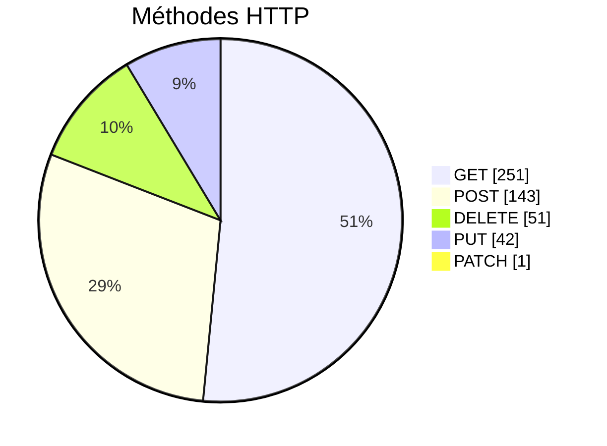
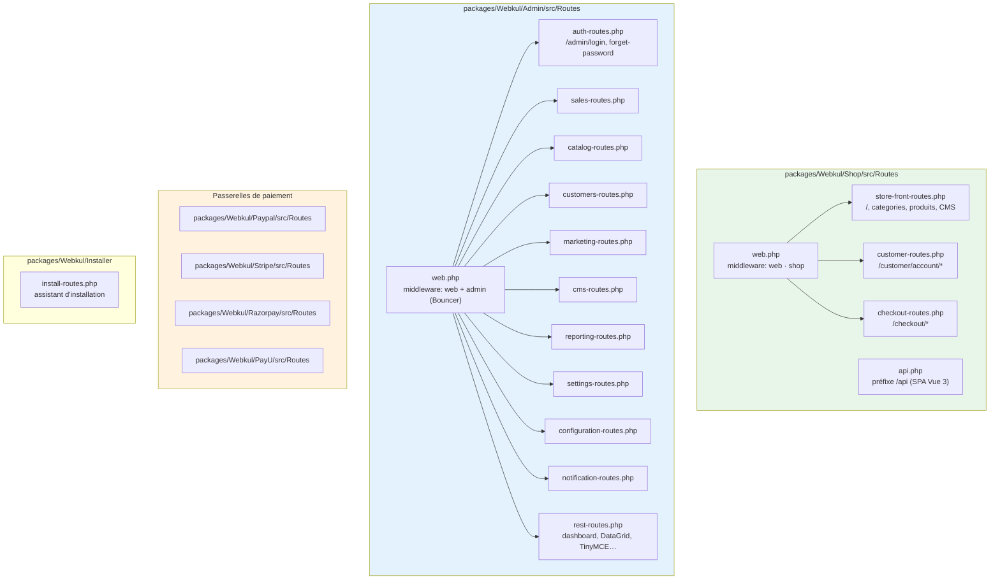
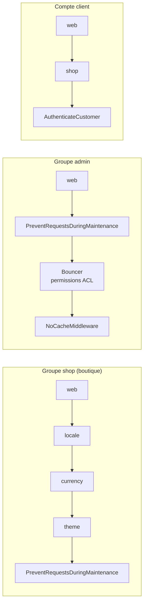
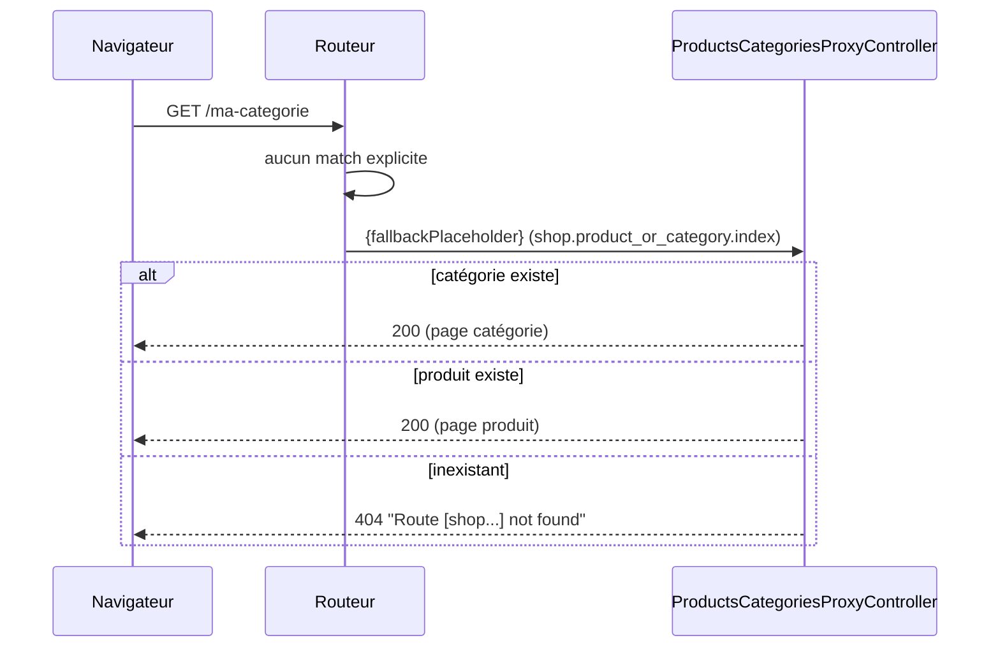

# Routes

**488 routes** enregistrées (`php artisan route:list`).

## 1. Chiffres

| Espace | Routes | Prefixed par |
|---|---|---|
| Admin | **335** | `/admin` (`config('app.admin_url')`) |
| Compte client (boutique) | 52 | `/customer` |
| API boutique (SPA) | 41 | `/api` |
| PayPal | 6 | `/paypal` |
| Debugbar (dev) | 6 | `/_debugbar` |
| Stripe | 5 | `/stripe` |
| Installer | 5 | `/install` |
| PayU | 4 | `/payu` |
| Razorpay | 3 | `/razorpay` |
| Checkout HTML | 3 | `/checkout` |
| Autres (search, contact-us, storage, sanctum, up…) | 20 | — |
| Route catch-all | 1 | `{fallbackPlaceholder}` → 404 |

## 2. Arborescence des fichiers de routes

> `Shop\Providers\ShopServiceProvider` crée le groupe `shop`
> (`locale`, `currency`, `theme`, `customer`, `cache.response`) puis charge
> `Routes/web.php` et `Routes/api.php`.
> `Admin\Providers\AdminServiceProvider` charge `Routes/web.php` (groupe `admin` + `NoCacheMiddleware`).

## 3. Chaînes de middlewares

| Nb routes | Chaîne |
|---|---|
| 335 | `web` → `PreventRequestsDuringMaintenance` → **`Bouncer` (ACL admin)** → `NoCacheMiddleware` |
| 52 | `web` → **`shop`** (`locale`, `currency`, `theme`) → `PreventRequestsDuringMaintenance` |
| 40 | idem + **`AuthenticateCustomer`** → `NoCacheMiddleware` (compte client connecté) |
| 16 | `web` seules (install, auth, webhook…) |
| 9 | `web` → `PreventRequestsDuringMaintenance` |

## 4. Détail par module

### 4.1 Boutique (`shop.*`) — 101 routes nommées

| Segment | Nb | Exemples d'URL |
|---|---|---|
| `customers` | 46 | `/customer/account/orders`, `/customer/login`, `/customer/register` |
| `api` | 36 | `/api/categories`, `/api/checkout/cart`, `/api/products/{id}` |
| `checkout` | 8 | `/checkout/cart`, `/checkout/onepage` |
| `customer` | 4 | `/customer/forgot-password`, `/customer/reset-password` |
| `home` | 3 | `/` (accueil), `/contact-us` |
| `search` | 2 | `/search` |
| `subscription` | 2 | newsletter |
| `product_or_category` | 1 | **catch-all** `{slug}` → page produit/catégorie |
| `product`, `compare`, `cms`, `booking-product`, `downloadable` | 5 | pages produit, comparaison, CMS… |

> **C'est ce catch-all qui renvoie 404** quand la catégorie demandée n'existe pas
> (cas actuel : seuls `Root` et 0 produit sont en base).

### 4.2 Admin (`admin.*`) — 335 routes

| Module | Nb | Contenu |
|---|---|---|
| `sales` | 75 | commandes, factures, expéditions, remboursements, paniers, **RMA (43)** |
| `settings` | 74 | canaux, devises, taxes, sources de stock, thème, rôles, users, DataTransfer |
| `marketing` | 57 | cart rules, catalog rules, campagnes, SEO (terms, synonyms, URL rewrite, sitemap) |
| `catalog` | 43 | produits (14), catégories (10), attributs (8), familles (6) |
| `customers` | 38 | clients, groupes, adresses, avis, wishlist, compare, GDPR |
| `reporting` | 15 | ventes, produits, clients |
| `cms` | 7 | pages CMS |
| `two_factor` | 5 | double authentification admin |
| `datagrid` | 5 | filtres sauvegardés |
| `notification`, `configuration` | 8 | notifications, configuration système |
| `session`, `account`, `reset_password`, `forget_password` | 9 | auth admin |
| `magic_ai`, `dashboard`, `tinymce`, `customer` | 7 | dashboard, IA, éditeur |

### 4.3 API SPA (`/api`)

| Groupe | Routes | Rôle |
|---|---|---|
| `/api/core` | 2 | pays, états |
| `/api/categories` | 5 | arbre, filtres, prix max |
| `/api/products` | 3 | liste, related, up-sell |
| `/api/product/{id}` | 3 | avis |
| `/api/compare-items` | 4 | comparateur |
| `/api/checkout/cart` | 10 | panier, coupon, shipping estimé, cross-sell |
| `/api/checkout/onepage` | 5 | résumé, adresse, livraison, paiement, commande |
| `/api/customer` | 1 | login |
| `/api/customer/addresses`, `/api/customer/wishlist` | 7 | protégés middleware `customer` (Sanctum) |

### 4.4 Paiements

| Passerelle | Routes | Rôle |
|---|---|---|
| PayPal | 6 | `standard`, `smart-button` (retour, success, cancel) |
| Stripe | 5 | intent, webhook (`Laravel\Cashier` webhook inclus) |
| PayU | 4 | hash, réponse, success/failure |
| Razorpay | 3 | order, verify |

## 5. Routes sans nom

| Méthode | URI | Rôle |
|---|---|---|
| GET | `/admin` | redirection vers `/admin/login` |
| GET | `/admin/catalog/sync` | synchronisation catalogue |
| GET | `/up` | health check Laravel |
