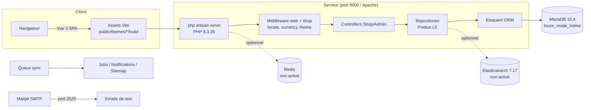

# Stack technique

## Runtime & framework

| Composant | Version | Rôle |
|---|---|---|
| PHP | **8.3.35** NTS (`C:\xampp\php8.3`) | Runtime CLI — exigé `^8.3` par `composer.json` |
| PHP (Apache) | 8.2.12 (`C:\xampp\php`) | Module Apache XAMPP — **à upgrader** pour servir le projet sur le port 80 |
| Laravel | 12.55.0 | Framework applicatif (routes, Eloquent, queues, cache) |
| LouzirModeIntime | 2.4.0 | E-commerce (catalogue, panier, commandes, admin) |
| Concord | 1.17.1 | Module system (Contract / Model / Proxy par entité) |
| Prettus L5 Repository | 2.10.1 | Pattern Repository sur toutes les entités |

### Extensions PHP actives (php.ini de `C:\xampp\php8.3`)

`bcmath, calendar, curl, dom, exif, fileinfo, ftp, gd, gettext, gmp, intl, mbstring, openssl, pdo_mysql, soap, sockets, tokenizer, tidy, xsl, zip`

Requises par `composer.json` : `calendar, curl, intl, mbstring, openssl, pdo, pdo_mysql, tokenizer` ✅

## Base de données & services

| Service | Version locale | Usage |
|---|---|---|
| MariaDB | 10.4.32 (XAMPP, port 3306) | BDD principale `louzir_mode_intime` |
| MySQL 8.0 | Docker (`docker-compose.yml`) | Alternative pour les environnements Sail |
| Redis | `redis:alpine` (Docker, **non utilisé** en local) | Cache/queue optionnels — ici `CACHE_STORE=file`, `QUEUE_CONNECTION=sync` |
| Elasticsearch | 7.17.0 (Docker, **non activé** — pas de `ELASTIC_*` dans `.env`) | Recherche produit optionnelle (`config/elasticsearch.php`) |
| Kibana | 7.17.0 (Docker) | Dashboards Elasticsearch |
| Mailpit | latest (Docker) | Boîte de test SMTP (`MAIL_PORT=2525`) |

### Configuration actuelle (`.env`)

```
DB_CONNECTION=mysql   DB_HOST=127.0.0.1   DB_PORT=3306
DB_DATABASE=louzir_mode_intime   DB_USERNAME=root   DB_PASSWORD=
SESSION_DRIVER=database    CACHE_STORE=file    QUEUE_CONNECTION=sync
APP_URL=http://localhost    APP_ADMIN_URL=admin    APP_CURRENCY=USD
```

## Frontend

| Composant | Version | Usage |
|---|---|---|
| Node.js | 22.13.1 | Outil build |
| npm | 10.9.2 | Gestionnaire de paquets |
| Vite | 5.4.21 | Bundler (3 configs : root, Shop, Admin) |
| laravel-vite-plugin | 1.x | Intégration Laravel ↔ Vite |
| Vue | 3 | SPA côté client (thèmes Shop & Admin) |
| axios | 1.x | Requêtes AJAX vers les routes `api.*` |

### 3 pipelines de build

| Entrée | Source | Sortie |
|---|---|---|
| `npm run build` (racine) | `resources/css/app.css`, `resources/js/app.js` | `public/build/` |
| `npm run build` (`packages/Webkul/Shop`) | `packages/Webkul/Shop/src/Resources/assets` | `public/themes/shop/default/build/` |
| `npm run build` (`packages/Webkul/Admin`) | `packages/Webkul/Admin/src/Resources/assets` | `public/themes/admin/default/build/` |

## Tests & qualité

| Outil | Version | Commande |
|---|---|---|
| Pest | 3.8.6 | `php artisan test --compact` |
| PHPUnit | 11.5.50 | suites définies dans `phpunit.xml` |
| Playwright | 1.58.1 | `cd packages/Webkul/Admin/tests/e2e-pw && npx playwright test` (idem `Shop`) |
| Pint | 1.29.0 | `vendor/bin/pint --dirty` (preset `laravel`, config `pint.json`) |
| Laravel Debugbar | 3.16.5 | Injection UI debug (actif en local) |
| Laravel Boost | 2.3.4 | Middleware dev (logs navigateur `_boost/browser-logs`) |
| bagisto/laravel-datafaker | 2.3.0 | `php artisan bagisto:fake` — données de démo |

## CI GitHub Actions

| Workflow | Déclencheur | Action |
|---|---|---|
| `pest_tests.yml` | push, PR | Installe LouzirModeIntime + `vendor/bin/pest` |
| `pint_tests.yml` | push, PR | `pint --test` |
| `admin_playwright_tests.yml` | push, PR | E2E admin |
| `shop_playwright_tests.yml` | push, PR | E2E boutique |
| `translation_tests.yml` | push, PR | Cohérence des clés de traduction (21 locales) |

## Modules paiement installés

`CashOnDelivery`, `MoneyTransfer` (base), **PayPal**, **Stripe**, **Razorpay**, **PayU**, `laravel/cashier` (abonnements Stripe).

## Détails Mermaid


