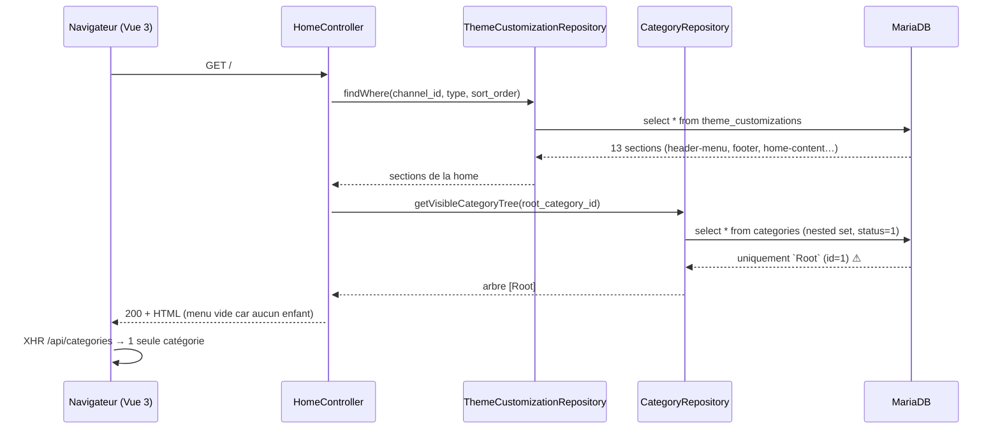
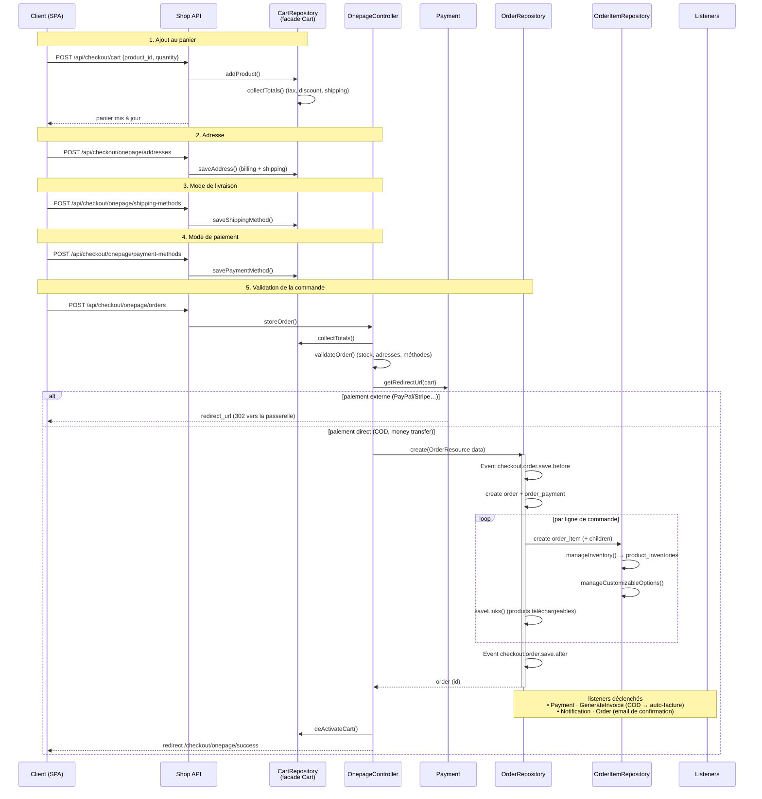
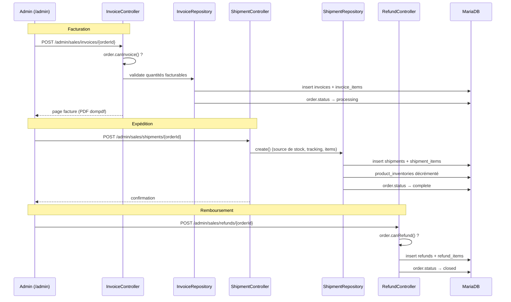
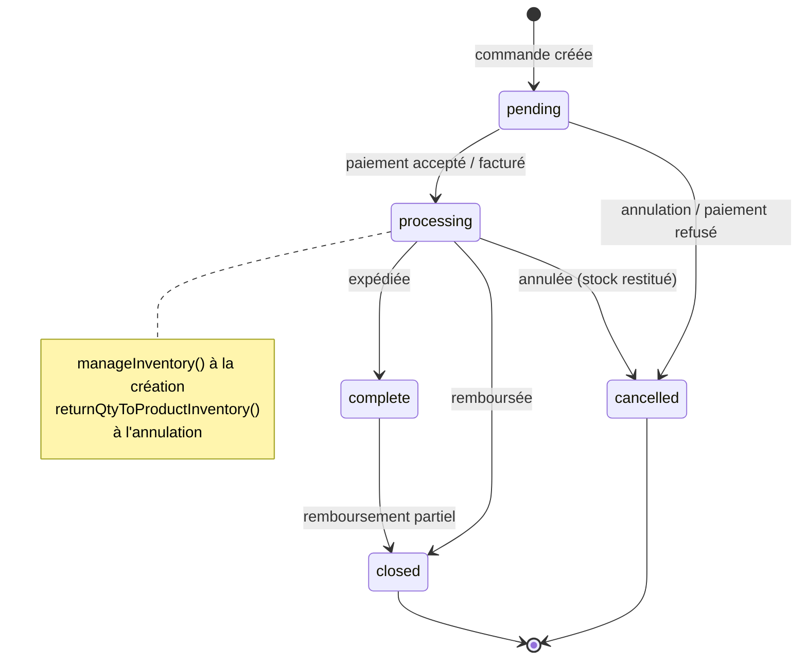
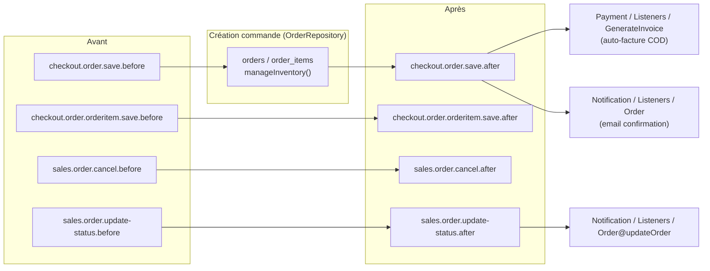
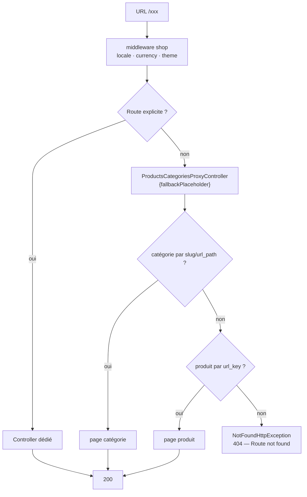

# Workflows métier (séquences Mermaid)

## 1. Page d'accueil de la boutique

> **Anomalie courante** : sans catégorie fille, le menu est vide.
> Toute URL type `/lingerie` → `ProductsCategoriesProxyController` → **404**.

## 2. Panier → commande (checkout one-page)

## 3. Admin : facture, expédition, remboursement

## 4. Cycle de vie d'une commande

## 5. Événements métier (`Event::dispatch`)

| Événement | Listener | Package |
|---|---|---|
| `checkout.order.save.after` | `Payment\Listeners\GenerateInvoice@handle` | Payment |
| `checkout.order.save.after` | `Notification\Listeners\Order@createOrder` | Notification |
| `sales.order.update-status.after` | `Notification\Listeners\Order@updateOrder` | Notification |
| `bagisto.installed` | `Installer\Listeners\Installer@installed` | Installer |

## 6. Chemin d'une requête produit/catégorie (catch-all)

